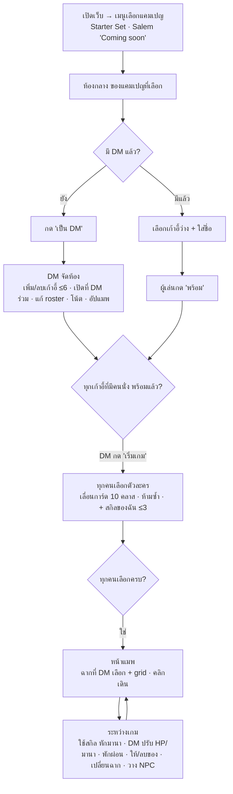

# Web flow — v0 (draft)

**สถานะ:** ร่าง v0 อัปเดตตามของจริง v0.12.0 (roster 10 คลาส) · ที่มา: [`../conversations/2026-10-16-web-flow.md`](../conversations/2026-10-16-web-flow.md) · [conv roster](../conversations/2026-10-16-character-roster.md)
ส่วนที่ขีดฆ่า (~~...~~) = แผนเดิมที่ถูกแทนแล้ว เก็บไว้ให้เห็นประวัติ
จุดที่เขียนว่า **(สมมติ)** = ผู้ใช้ยังไม่ได้บอก รอคำตอบใน [`../open-questions.md`](../open-questions.md)

## หลักการ
- ~~**White label**: โค้ดไม่ fix stat/skill ของ D&D — DM สร้าง "ชุดกฎ" (ruleset) เอง: มี stat อะไร, skill อะไร, ไอเทมอะไร, แต้มเริ่มต้นเท่าไร~~ → แทนด้วย [conv roster](../conversations/2026-10-16-character-roster.md)
- **ตัวละครสำเร็จรูป 10 คลาส (roster)**: ทุกตัวมี stat ชุดเดียวกัน (เลือด HP, ความแข็งแกร่ง STR, ความทนทาน END, ความว่องไว AGI, มานา MP) ค่าต่างกัน + สกิลติดตัวที่ใช้มานา + ของติดตัว; ข้อมูลอยู่ที่ [`roster.md`](roster.md) (เนื้อหาแต่งเอง ไม่ใช้ข้อความ SRD) · DM แก้ roster ได้ในแอป
- **NPC Pool ยังเป็น white label**: DM สร้าง NPC เอง (รูป, ชื่อ, เลือด, ปกปิด)
- **ใช้ส่วนตัว**: กลุ่มเพื่อน ไม่ทำระบบสมัครสมาชิก · **ห้องเดียวทั้งเว็บ ไม่มีรหัสผ่าน** (ใครรู้ URL ก็เข้าได้ — ยอมรับแล้ว)
- **DM มีอำนาจสุดท้าย**: ระบบช่วยจด/คำนวณ แต่ DM แก้ทับได้ทุกอย่าง

## บทบาท
| บทบาท | จำนวน | ได้มาอย่างไร | ทำอะไรได้ |
|---|---|---|---|
| DM หลัก | 1 | คนแรกที่กด "เป็น DM" | ทุกอย่าง: จัดห้อง, เพิ่ม/ลบเก้าอี้, เพิ่ม DM ร่วม, แก้ roster, อัป/เลือกแมพ, ปรับ HP/มานา/stat, ให้/ลบของ, พักผ่อน, โน้ต, NPC Pool, เริ่มเกม |
| DM ร่วม | 0–1 | DM หลักเปิดเก้าอี้ DM ที่ 2 | เท่า DM หลัก ยกเว้นลบ DM หลัก (ยืนยันแล้ว) |
| ผู้เล่น | 1–6 | นั่งเก้าอี้ว่างที่ DM เปิดไว้ | เลือกตัวละคร 1 ใบ, เพิ่มสกิลของตัวเอง, ใช้สกิล (หักมานา), ขยับ token ตัวเอง, กดพร้อม |
| ผู้ชม | — | (สมมติ) ไม่มีใน v0 | — |

## ภาพรวม flow


## สถานะห้อง (state machine)


## หน้าจอทีละขั้น
### 0. เมนูเลือกแคมเปญ (หน้าแรก) — ยืนยันแล้ว 2026-10-16
| แคมเปญ | สถานะ |
|---|---|
| **Starter Set: Dragons of Stormwreck Isle** (เริ่มจากบทนำฟรี) | เล่นได้ (แคมเปญแรก) — [`../campaigns/starter-set/`](../campaigns/starter-set/) |
| **Salem** | "Coming soon" กดไม่ได้ — [`../campaigns/salem/`](../campaigns/salem/) |

- แคมเปญกำหนด: ~~ruleset preset เริ่มต้น~~ (ใช้ roster ร่วมกันทุกแคมเปญ), รายชื่อฉาก/แมพที่ DM ต้องอัป, NPC ที่เตรียมไว้
- **DM เป็นคนเลือก** (ยืนยันแล้ว)
- ห้องยังมีห้องเดียว → ถ้ามีเกมค้างอยู่ หน้าแรกพาเข้าห้องนั้นเลย (สมมติ)

### 1. ห้องกลาง / Lobby
- เห็น: ชื่อห้อง, เก้าอี้ DM (1–2), เก้าอี้ผู้เล่น (ตามที่ DM เปิด สูงสุด 6), ใครนั่งที่ไหน, ใครพร้อมแล้ว
- ยังไม่มี DM → ปุ่ม **"เป็น DM"**
- มี DM แล้ว → คลิกเก้าอี้ว่าง → ใส่ชื่อ → นั่ง
- **เน็ตหลุด/กลับเข้า**: ใส่เลขห้อง → กลับเข้าเก้าอี้เดิม (รายละเอียดรอ Q13 ใน [`../open-questions.md`](../open-questions.md))
- ผู้เล่น: ปุ่ม **"พร้อม / ยังไม่พร้อม"**
- DM: **+ เก้าอี้ / − เก้าอี้**, **เปิดที่ DM ร่วม**, เตะคนออกจากเก้าอี้ (สมมติ), QR เข้านั่ง ([spec](../features/seat-qr.md)), ปุ่ม **"ชุดกฎ / Ruleset"** (= ตัวแก้ roster), **โน้ตเนื้อเรื่อง**, ปุ่ม **"แมพ"**, ปุ่ม **"เริ่มเกม"** (กดได้เมื่อทุกคนที่นั่งอยู่พร้อม)

### 2. ชุดกฎ / Ruleset = ตัวแก้ roster (DM)
~~DM กำหนด ruleset เอง: Stat (ชื่อ + min/max/เริ่มต้น), แต้ม stat, Skill + จำนวนที่เลือกได้, คลังไอเทม + ไอเทมเริ่มต้น, preset "D&D 5e (SRD 5.2.1)" + attribution SRD~~ → ลบ v0.12.0 ([conv roster](../conversations/2026-10-16-character-roster.md))

เปิดได้จาก lobby และเมนู DM ระหว่างเกม ([spec](../features/character-roster.md#หน้า-ruleset--ตัวแก้-roster-คำขอเพิ่ม-3))
- รายการ 10 ตัวละคร (รูป + ชื่อ + คลาส) → คลิกเปิดตัวแก้
- แก้ได้: ชื่อฮีโร่ / ชื่อคลาส / คำโปรย (TH + EN), รูป (10 รูปคลาส หรืออัปโหลดเอง), stat (hpMax 1–999, str/end/agi 0–20, mpMax 0–99), สกิลติดตัว 1–5 อัน (มานา 0–10), ของเริ่มต้น 0–10 ชิ้น
- **รีเซ็ตตัวนี้ / รีเซ็ตทั้งหมด** กลับค่าเริ่มต้นใน [`roster.md`](roster.md)
- มีผลกับตัวที่ **ถูกเลือกหลังแก้** เท่านั้น · เก็บถาวรใน `data/roster.json`

### 3. เลือกตัวละคร (ผู้เล่นทุกคนพร้อมกัน)
~~1. ชื่อ + อัปรูป 2. เลือกสกิลเริ่มต้น 3. กระจาย stat point 4. ไอเทมเริ่มต้นจาก ruleset 5. กด "เสร็จ"~~ → แทนด้วยการเลือกการ์ด ([conv roster](../conversations/2026-10-16-character-roster.md))
1. **การ์ด carousel** 10 ใบ: ปัด/ลาก, ปุ่ม ‹ ›, คีย์ ←/→, จุดบอกตำแหน่ง · animation ด้วย `motion` (เคารพ `prefers-reduced-motion`)
2. การ์ด: รูปคลาส, ชื่อฮีโร่ + คลาส, คำโปรย, แถบ stat 5 ค่า, สกิลติดตัว (ชื่อ + มานา + ⓘ), ของติดตัว
3. กด **"เลือกตัวนี้"** — คลาสที่คนอื่นเลือกแล้ว การ์ดเทา + ป้าย "ถูกเลือกแล้ว: <ชื่อผู้เล่น>"
4. หลังเลือก: **"สกิลของฉัน"** เพิ่มสกิลเอง (ชื่อ, คำอธิบาย, มานา) สูงสุด 3 อัน — ข้ามได้ เพิ่มทีหลังได้
5. ทุกคนเลือกครบ → หน้าแมพ

DM ระหว่างนี้: เห็นว่าใครเลือกอะไร (ไม่มีปุ่มเลือก) · เครดิตรูปคลาส (game-icons.net, CC BY 3.0) อยู่ footer หน้านี้

### 4. แมพ (เล่นเกม)
- แสดงแมพของฉากปัจจุบัน + **grid** ซ้อนทับ
- token ตัวละครทุกตัว (ใช้รูปคลาส ไม่ต้องอัป portrait)
- ผู้เล่น: คลิก token ตัวเอง → คลิกช่องปลายทาง → เดิน (sync ให้ทุกคนเห็นทันที)
- ผู้เล่น: **ชีท** = HP bar, มานา bar, str/end/agi, สกิลติดตัว + สกิลของฉัน (เพิ่ม/แก้/ลบได้) + ปุ่ม **"ใช้"** (หักมานาอัตโนมัติ, ปิดเมื่อมานาไม่พอ), ของติดตัว
- ทุกคน: แผง **บันทึก / Feed** การกระทำล่าสุด 50 รายการ (เช่น "Aldric ใช้ Shield Wall (−2 มานา)")
- DM:
  - **คลังแมพ**: อัปรูปแมพ, ตั้งขนาด grid ให้ตรงกับรูป, ตั้งชื่อฉาก
  - **เลือกฉาก**: กดแล้วทุกคนย้ายไปฉากนั้น
  - **แถบปาร์ตี้**: รูปกลมของทุกตัวละคร + เส้น HP/มานาเล็ก → คลิก = **การ์ดโปรไฟล์** ลอยมุมขวาล่าง: stat ทั้ง 5 (HP/มานา −/+), แก้ stat, สกิล, กระเป๋า (**ให้ของ** พิมพ์ชื่อ + จำนวน, ลบ −1 / ลบทั้งกอง)
  - ปุ่ม **"พักผ่อน"**: มานาเต็มทุกคน (HP ไม่ฟื้น)
  - **NPC Pool** ([spec](../features/npc-pool.md)): สร้าง NPC (รูป, ชื่อ, เลือด, ปกปิด) เก็บใน `data/npcs.json` → วางบนแมพได้หลายตัว · ซ่อน/เปิดเผย token (ปกปิด = ผู้เล่นไม่เห็นเลย กรองที่ server) · HP NPC −/+ เห็นแค่ DM
  - **โน้ตเนื้อเรื่อง** ([spec](../features/dm-notes.md)): หลายโน้ต บันทึกอัตโนมัติ เก็บใน `data/notes.json` ผู้เล่นไม่เห็น
  - **Fog of war** (ยืนยันแล้ว): DM วาดสี่เหลี่ยมซ่อน/เปิดพื้นที่บนแมพ ผู้เล่นเห็นเฉพาะส่วนที่เปิด DM เห็นทั้งหมด (แบบโปร่ง)
  - ~~เปิดตัวละครผู้เล่น → ให้ไอเทม/สกิล/แก้ stat~~ → ย้ายเข้าการ์ดโปรไฟล์ (ด้านบน)
- **เดินอิสระ** (ยืนยันแล้ว): ไม่จำกัดระยะ ไม่มีตาเดิน — DM คุมด้วยการพูด
- ~~ทอยเต๋า + log~~ → **ตัดออก 2026-10-16: ใช้ลูกเต๋าจริง** ([conv](../conversations/2026-10-16-remove-dice.md)) · กติกาสั้นสำหรับ DM อยู่ใน [`roster.md`](roster.md)

## Data model (ตามของจริง — ฉบับเต็ม [`protocol.md`](protocol.md))
~~`Ruleset { stats: StatDef[], statPoints, skills: SkillDef[], startingSkillPicks, items: ItemDef[], startingItems }` · `StatDef` · `SkillDef` · `ItemDef` · `Character { stats: {key: value}, skillIds[], inventory: {itemId, qty}[] }`~~ → ลบ v0.12.0
```
L           { th, en }                                   ข้อความ 2 ภาษา
Campaign    { id, name, status: available|coming_soon, sceneTemplates[] }
Room        { id, name, campaignId, status: lobby|creating|playing, currentSceneId,
              roster: RosterEntry[], characters: Character[], feed: FeedEntry[] }
Seat        { id, roomId, kind: dm|codm|player, order, occupantName?, ready, characterId? }
RosterEntry { id (classId), heroName: L, className: L, blurb: L, role, art,
              stats: {hpMax, str, end, agi, mpMax}, skills: {id, name: L, desc: L, cost}[1..5],
              items: {name: L, qty}[0..10] }                 เก็บ data/roster.json
Character   { id, seatId, classId, name: L, art, hp, hpMax, mp, mpMax, str, end, agi,
              skills: {id, kind: innate|custom, name: L, desc: L, cost}[], items: {name: L, qty}[] }
FeedEntry   { at, text: L }                              ล่าสุด 50
Scene       { id, name, mapImageUrl, grid: {cellSize, offsetX, offsetY, cols, rows}, fog: {x, y, w, h}[] }
Token       { id, sceneId, characterId | npcId, name, imageUrl, col, row, hidden?, hp?, hpMax? }   hp/hidden เฉพาะ NPC, ส่งให้ DM เท่านั้น
Npc         { id, name, imageUrl, hpMax, hidden }        NPC Pool, เก็บ data/npcs.json
Note        { id, title, body, updatedAt }               DM เท่านั้น, เก็บ data/notes.json
```

## ไม่อยู่ใน v0
~~ซ่อน token~~ (มีแล้วผ่าน NPC Pool), เซฟเกมข้าม session (state ห้องอยู่ใน server ตราบที่ยังรัน; เฉพาะ roster/NPC Pool/โน้ตเก็บใน `data/`), รหัสผ่านห้อง, initiative/ตาเดิน, ไม้บรรทัด, แชท, เสียง (ใช้ Discord) — backlog ใน [`../ideas.md`](../ideas.md)
