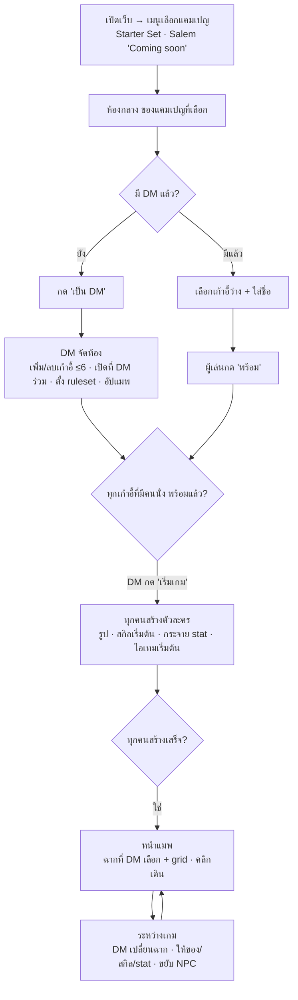
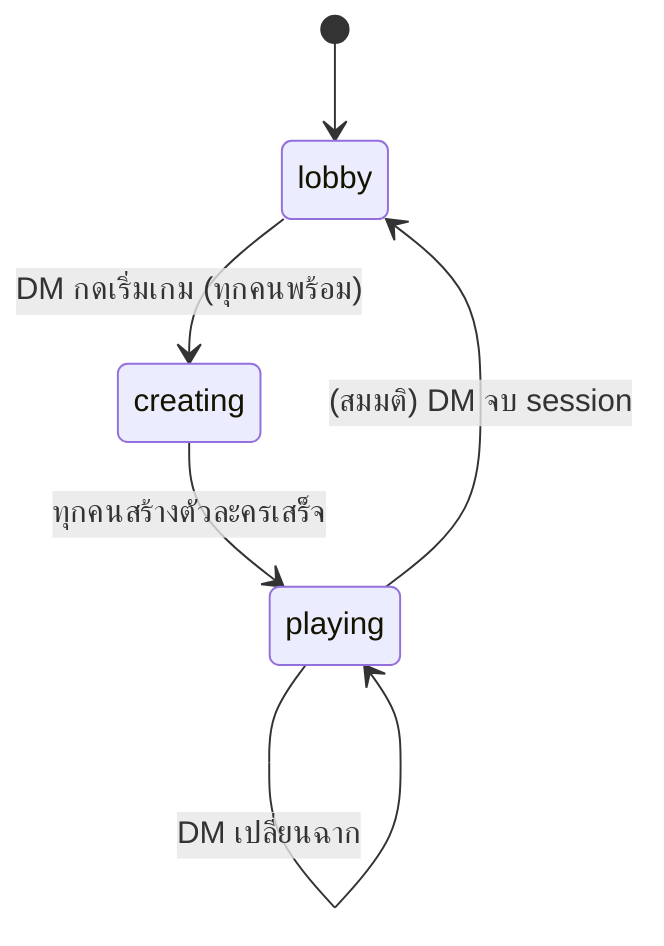

# Web flow — v0 (draft)

**สถานะ:** ร่าง ยังไม่ยืนยัน · ที่มา: [`../conversations/2026-10-16-web-flow.md`](../conversations/2026-10-16-web-flow.md)
จุดที่เขียนว่า **(สมมติ)** = ผู้ใช้ยังไม่ได้บอก รอคำตอบใน [`../open-questions.md`](../open-questions.md)

## หลักการ
- **White label**: โค้ดไม่ fix stat/skill ของ D&D — DM สร้าง "ชุดกฎ" (ruleset) เอง: มี stat อะไร, skill อะไร, ไอเทมอะไร, แต้มเริ่มต้นเท่าไร
- **ใช้ส่วนตัว**: กลุ่มเพื่อน ไม่ทำระบบสมัครสมาชิก · **ห้องเดียวทั้งเว็บ ไม่มีรหัสผ่าน** (ใครรู้ URL ก็เข้าได้ — ยอมรับแล้ว)
- **DM มีอำนาจสุดท้าย**: ระบบช่วยจด/คำนวณ แต่ DM แก้ทับได้ทุกอย่าง

## บทบาท
| บทบาท | จำนวน | ได้มาอย่างไร | ทำอะไรได้ |
|---|---|---|---|
| DM หลัก | 1 | คนแรกที่กด "เป็น DM" | ทุกอย่าง: จัดห้อง, เพิ่ม/ลบเก้าอี้, เพิ่ม DM ร่วม, ตั้ง ruleset, อัป/เลือกแมพ, ให้ของ/สกิล/stat, เริ่มเกม |
| DM ร่วม | 0–1 | DM หลักเปิดเก้าอี้ DM ที่ 2 | เท่า DM หลัก ยกเว้นลบ DM หลัก (ยืนยันแล้ว) |
| ผู้เล่น | 1–6 | นั่งเก้าอี้ว่างที่ DM เปิดไว้ | สร้างตัวละครตัวเอง, ขยับ token ตัวเอง, กดพร้อม |
| ผู้ชม | — | (สมมติ) ไม่มีใน v0 | — |

## ภาพรวม flow


## สถานะห้อง (state machine)


## หน้าจอทีละขั้น
### 0. เมนูเลือกแคมเปญ (หน้าแรก) — ยืนยันแล้ว 2026-10-16
| แคมเปญ | สถานะ |
|---|---|
| **Starter Set: Dragons of Stormwreck Isle** (เริ่มจากบทนำฟรี) | เล่นได้ (แคมเปญแรก) — [`../campaigns/starter-set/`](../campaigns/starter-set/) |
| **Salem** | "Coming soon" กดไม่ได้ — [`../campaigns/salem/`](../campaigns/salem/) |

- แคมเปญกำหนด: ruleset preset เริ่มต้น, รายชื่อฉาก/แมพที่ DM ต้องอัป, NPC ที่เตรียมไว้
- **DM เป็นคนเลือก** (ยืนยันแล้ว)
- ห้องยังมีห้องเดียว → ถ้ามีเกมค้างอยู่ หน้าแรกพาเข้าห้องนั้นเลย (สมมติ)

### 1. ห้องกลาง / Lobby
- เห็น: ชื่อห้อง, เก้าอี้ DM (1–2), เก้าอี้ผู้เล่น (ตามที่ DM เปิด สูงสุด 6), ใครนั่งที่ไหน, ใครพร้อมแล้ว
- ยังไม่มี DM → ปุ่ม **"เป็น DM"**
- มี DM แล้ว → คลิกเก้าอี้ว่าง → ใส่ชื่อ → นั่ง
- **เน็ตหลุด/กลับเข้า**: ใส่เลขห้อง → กลับเข้าเก้าอี้เดิม (รายละเอียดรอ Q13 ใน [`../open-questions.md`](../open-questions.md))
- ผู้เล่น: ปุ่ม **"พร้อม / ยังไม่พร้อม"**
- DM: **+ เก้าอี้ / − เก้าอี้**, **เปิดที่ DM ร่วม**, เตะคนออกจากเก้าอี้ (สมมติ), ปุ่ม **"ตั้งค่ากฎ"**, ปุ่ม **"แมพ"**, ปุ่ม **"เริ่มเกม"** (กดได้เมื่อทุกคนที่นั่งอยู่พร้อม)

### 2. ตั้งค่ากฎ (DM) — หัวใจของ white label
DM กำหนด ruleset ได้ตั้งแต่ใน lobby และแก้ระหว่างเกมได้
- **Stat**: ลิสต์ชื่อ stat (เช่น STR, DEX, Faith, Sanity) + ค่าต่ำสุด/สูงสุด/เริ่มต้น
- **แต้ม stat**: ผู้เล่นได้กี่แต้มไปกระจายตอนสร้างตัวละคร
- **Skill**: ลิสต์สกิล (ชื่อ, คำอธิบาย, ผูกกับ stat ไหน — ไม่บังคับ) + ผู้เล่นเลือกได้กี่อันตอนเริ่ม
- **ไอเทม**: คลังไอเทม (ชื่อ, คำอธิบาย, จำนวน) + ชุดไอเทมเริ่มต้นที่ทุกคนได้
- **(สมมติ)** ค่าพิเศษอย่าง HP เป็น stat ธรรมดาที่ DM สร้างเอง
- **Preset "D&D 5e (SRD 5.2.1)"** (ยืนยันแล้ว): กดโหลด 6 ability + 18 skill แล้วแก้ต่อได้ — ต้องแสดงข้อความ attribution SRD ([research](../research/dnd-basics.md))
- (ไอเดีย) preset "Salem" — ดู [`../ideas.md`](../ideas.md)

### 3. สร้างตัวละคร (ผู้เล่นทุกคนพร้อมกัน)
1. ชื่อ + อัปรูป (portrait ใช้เป็น token บนแมพด้วย)
2. เลือกสกิลเริ่มต้น ตามจำนวนที่ DM กำหนด
3. กระจาย stat point — แสดงแต้มเหลือ, ห้ามเกิน min/max
4. ไอเทมเริ่มต้น — ได้อัตโนมัติจาก ruleset
5. กด **"เสร็จ"**

DM ระหว่างนี้: เห็นสถานะของทุกคน, เพิ่มไอเทม/สกิลให้ใครก็ได้, (สมมติ) แก้ stat ให้ได้

### 4. แมพ (เล่นเกม)
- แสดงแมพของฉากปัจจุบัน + **grid** ซ้อนทับ
- token ตัวละครทุกตัว (ใช้รูปที่อัป)
- ผู้เล่น: คลิก token ตัวเอง → คลิกช่องปลายทาง → เดิน (sync ให้ทุกคนเห็นทันที)
- DM:
  - **คลังแมพ**: อัปรูปแมพ, ตั้งขนาด grid ให้ตรงกับรูป, ตั้งชื่อฉาก
  - **เลือกฉาก**: กดแล้วทุกคนย้ายไปฉากนั้น
  - วาง/ขยับ token NPC (เช่น ชาวเมือง; แม่มดปลอมตัวเป็นหนึ่งในนั้น) — ซ่อน token ไม่อยู่ใน v0
  - **Fog of war** (ยืนยันแล้ว): DM วาดสี่เหลี่ยมซ่อน/เปิดพื้นที่บนแมพ ผู้เล่นเห็นเฉพาะส่วนที่เปิด DM เห็นทั้งหมด (แบบโปร่ง)
  - เปิดตัวละครผู้เล่น → ให้ไอเทม/สกิล/แก้ stat
- **เดินอิสระ** (ยืนยันแล้ว): ไม่จำกัดระยะ ไม่มีตาเดิน — DM คุมด้วยการพูด
- ~~ทอยเต๋า + log~~ → **ตัดออก 2026-10-16: ใช้ลูกเต๋าจริง** ([conv](../conversations/2026-10-16-remove-dice.md))

## Data model (ร่าง)
```
Campaign    { id, name, status: available|coming_soon, defaultRulesetId, sceneTemplates[] }
Room        { id, name, campaignId, status: lobby|creating|playing, currentSceneId, rulesetId }
Seat        { id, roomId, kind: dm|player, order, occupantName?, ready, characterId? }
Ruleset     { id, stats: StatDef[], statPoints, skills: SkillDef[], startingSkillPicks,
              items: ItemDef[], startingItems: {itemId, qty}[] }
StatDef     { key, name, min, max, base }
SkillDef    { id, name, description, statKey? }
ItemDef     { id, name, description, image? }
Character   { id, seatId, name, portraitUrl, stats: {key: value}, skillIds[], inventory: {itemId, qty}[] }
Scene       { id, name, mapImageUrl, grid: {cellSize, offsetX, offsetY, cols, rows}, fog: {x, y, w, h}[] }
Token       { id, sceneId, characterId? | npcName, imageUrl, col, row }
```

## ไม่อยู่ใน v0
ซ่อน token, เซฟเกมข้าม session (state อยู่ใน server ตราบที่ยังรัน), รหัสผ่านห้อง, initiative/ตาเดิน, ไม้บรรทัด, แชท, เสียง (ใช้ Discord) — backlog ใน [`../ideas.md`](../ideas.md)
