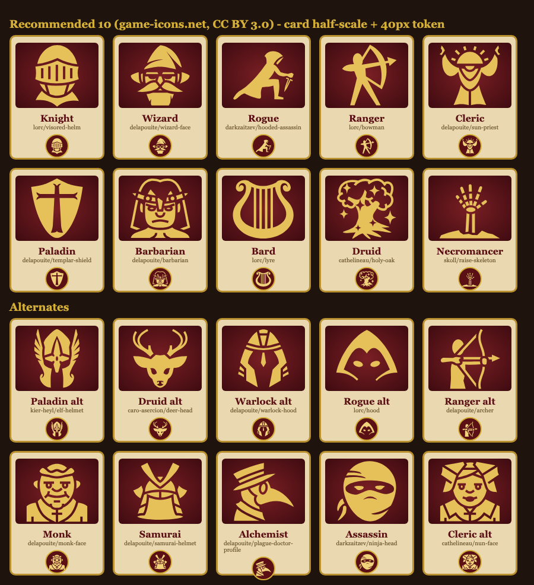

# Research: รูปตัวละคร 10 คลาส (2026-10-16)

ที่มา: [`../conversations/2026-10-16-character-roster.md`](../conversations/2026-10-16-character-roster.md) · agent `researcher` (ดาวน์โหลด zip จริง อ่าน license แล้ว render ตัวอย่าง)

## สรุป
- **แนะนำ: game-icons.net** — SVG silhouette 512×512, **CC BY 3.0**, ครบ 10 คลาส style เดียวกัน, ไฟล์ละ 0.8–6 KB, ลงสีด้วย CSS (ทองบนพื้น oxblood), ใช้ไฟล์เดียวได้ทั้งการ์ดและ token 40px
- **ต้องใส่เครดิต** (CC BY 3.0 §4b): ชื่อผู้วาด + ลิงก์ license + บอกว่าแก้ไข (เปลี่ยนสี)
- สำรอง: Kenney Tiny Dungeon (CC0, pixel 16px) — ใช้ได้แค่ token, คลาสไม่ครบ 10
- ไม่ใช้: Flare Portrait / LPC (share-alike + GPL), DiceBear (ไม่มีแนว fantasy), 0x72 / Ninja Adventure (คลาสไม่ครบ / ไม่ได้เปิดดูไฟล์)

## เทียบ
| ชุด | License | Style | 10 คลาส | หมายเหตุ |
|---|---|---|---|---|
| **game-icons.net** | CC BY 3.0 (บางไฟล์ CC0) | SVG silhouette | **ครบ** + สำรอง Monk/Samurai/Alchemist/Assassin | ต้องให้เครดิต |
| 0x72 DungeonTileset II | CC0 | pixel 16×28 | ~4–5 | ไม่มี bard/druid/cleric/paladin |
| Kenney Tiny Dungeon | CC0 | pixel 16×16 | ไม่ถึง 10 | fallback token |
| Ninja Adventure | CC0 | pixel | ไม่ได้ตรวจ | ธีม ninja ไม่เข้ายุคกลาง |
| Flare Portrait Pack | CC-BY-SA 3.0 / GPL | ภาพวาด portrait | 6 hero | share-alike ⚠ |
| LPC generator | ปนหลาย license | pixel 64×64 | ประกอบเอง | ต้องเครดิตทีละไฟล์, SA/GPL ⚠ |
| DiceBear | CC0 / CC BY 4.0 แล้วแต่ style | avatar การ์ตูน | 0 | ตัด |

## รายการที่แนะนำ (game-icons.net — เช็ก URL แล้วได้ 200 ทุกตัว)
| # | คลาส | ไฟล์ (author/name) | สำรอง |
|---|---|---|---|
| 1 | Knight | `lorc/visored-helm` | `delapouite/closed-barbute` |
| 2 | Wizard | `delapouite/wizard-face` | `lorc/wizard-staff` |
| 3 | Rogue | `darkzaitzev/hooded-assassin` | `lorc/hood` |
| 4 | Ranger | `lorc/bowman` | `delapouite/archer` |
| 5 | Cleric | `delapouite/sun-priest` | `cathelineau/nun-face` |
| 6 | Paladin | `delapouite/templar-shield` | `kier-heyl/elf-helmet` |
| 7 | Barbarian | `delapouite/barbarian` | `delapouite/viking-head` |
| 8 | Bard | `lorc/lyre` | `delapouite/jester-hat` |
| 9 | Druid | `cathelineau/holy-oak` | `caro-asercion/deer-head` |
| 10 | Necromancer | `skoll/raise-skeleton` | `delapouite/warlock-hood` |

URL: `https://game-icons.net/1x1/<author>/<name>.html` · ชุดเต็ม: `https://game-icons.net/archives/svg/zip/ffffff/transparent/game-icons.net.svg.zip` (มี `icons/license.txt`)

ข้อสังเกต: ชุดแนะนำปน 3 แบบ — หน้าคน (wizard, barbarian, cleric), ทั้งตัว (rogue, ranger), สัญลักษณ์ (shield, lyre, oak, มือโครงกระดูก); ที่ 40px hooded-assassin / sun-priest / barbarian เส้นละเอียด ควรเช็กบนมือถือจริง

## เครดิต (ใส่ใน footer หน้าเลือกตัวละคร)
> Class icons by Lorc, Delapouite, DarkZaitzev, Cathelineau and Skoll — game-icons.net — CC BY 3.0 (https://creativecommons.org/licenses/by/3.0/). Recolored.

(เพิ่ม Kier Heyl / Caro Asercion ถ้าใช้ตัวสำรองของเขา)

## แหล่งที่มา
[1] https://game-icons.net/about.html · [2] https://game-icons.net/archives/svg/zip/ffffff/transparent/game-icons.net.svg.zip · [3] https://creativecommons.org/licenses/by/3.0/legalcode.en · [4] https://0x72.itch.io/dungeontileset-ii · [5] https://kenney.nl/assets/tiny-dungeon · [6] https://pixel-boy.itch.io/ninja-adventure-asset-pack · [7] https://opengameart.org/content/flare-portrait-pack-number-one · [8] https://github.com/LiberatedPixelCup/Universal-LPC-Spritesheet-Character-Generator · [9] https://www.dicebear.com/licenses/
